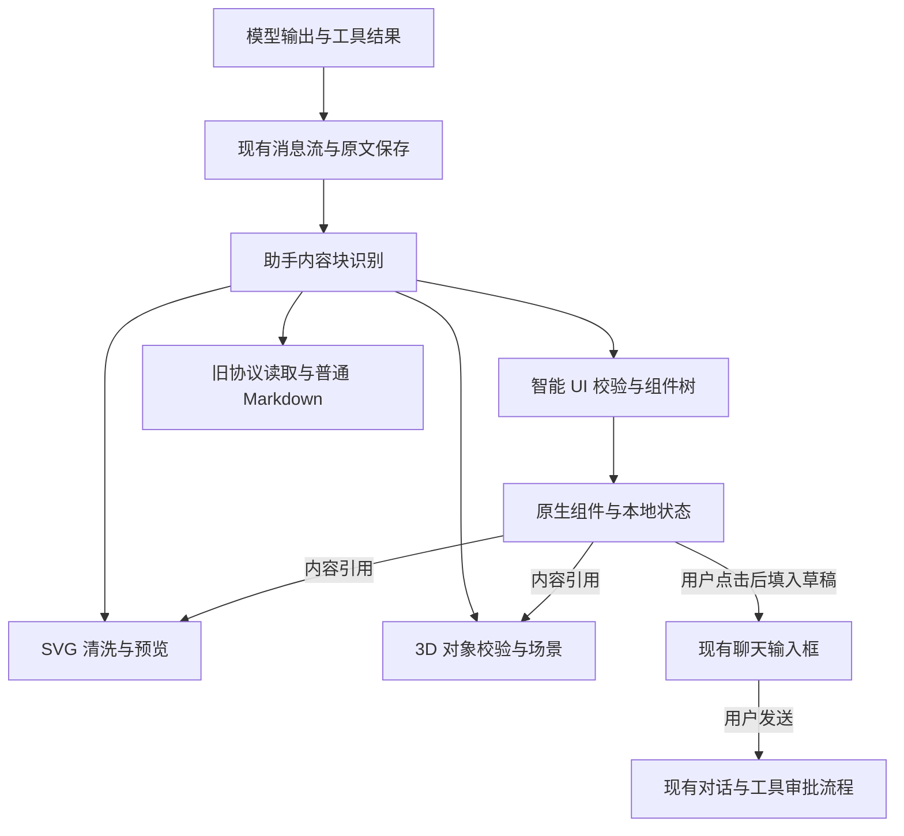

# Amber 鸿蒙智能 UI 与可视化内容分离计划

- 日期：2026-10-10
- 状态：P0–P4 实现已完成，必要回归通过，签名包已覆盖安装真机；未执行的原始验收项见实施记录
- 范围：先在 HarmonyOS 聊天界面落地；不修改 Android、DeepRead、小说产品，不新增依赖或云端服务。验证可以使用已有模型配置，不打印密钥或扩大权限。

## 1. 方向判断

### 核心结论

智能 UI 应成为宿主控制的任务界面，负责数据呈现、输入、选择、确认和局部状态。SVG 与 Three.js 应成为独立的可视化内容，分别负责矢量表达和三维场景。三者可以组合成同一条回答，但各自解析、校验、运行和降级。

模型提出界面与内容，Amber 决定能显示什么、怎样交互，以及哪些动作可以发生。第一版采用有限的声明式组件目录和本地校验，不建立任意 JavaScript 执行系统。

### 置信度

- 职责分离：高。用户已确认方向，现有原生界面、SVG 清洗、3D 对象校验和 MiniApp 权限体系也支持这条边界。
- 逐行组件记录作为生成协议：中。它可以隔离尾部截断，但现有模型能否稳定生成、是否产生足够好的界面，需要先验证。
- 当前 SVG 报错的根因：未确定。`Unexpected end Text in JSON` 证明解析输入未完整结束，不能区分模型漏写、输出限制、传输或本地处理问题。

### 继承约束与取舍

| 约束 | 是否真实 | 处理 |
|---|---|---|
| 旧会话、备份和用户生成内容需要继续可读 | 是 | 保留旧协议读取，不批量改写消息 |
| 鸿蒙 API 12 基线、V1 状态管理、主题重挂载 | 是 | 复用现有组件和状态方式，设备验收覆盖重挂载 |
| 用户已经使用的 MiniApp 执行和权限行为 | 是 | 独立保留，不把执行权限交给智能 UI |
| 所有内容必须经过 `GenerativeWidget` | 否 | 拆开这个过宽的内部概念，同步更新内部调用方 |
| 必须复制 ChatGPT 的 DIL 和服务端编译器 | 否 | 借鉴职责和恢复机制，先用本地声明式校验 |

### 从目标倒推

假设这套能力已经稳定：用户在一条回答里选择证书节点，详情立即变化；SVG 绘图失败时操作区仍可用；3D 画布进入操控前不抢聊天滚动；生成到一半断开，已有内容仍在；重开会话可恢复来源和已保存的 UI 草稿。

由此倒推，优先解决协议提交单位、状态所有权和错误边界，再扩充组件数量、动效或图形格式。

### 应拆开、保留和停止的做法

- 拆开任务界面与可视化产物；智能 UI 不再是 `show-widget` 的另一种 `renderer`。
- 保留既有 SVG 清洗、3D normalizer、WebGL 降级、消息原文和 MiniApp 运行权限。
- 新 SVG 生成不再把整段 XML 放入 `widget_code` JSON 字符串。
- 停止把所有卡片都标为 HTML、统一通过 HTML 导出的行为；按内容类型明确导出结果。
- 停止让模型为常见表单、选择器和按钮自行生成布局代码、事件脚本和任意样式。
- 原生智能 UI 不经过 WebView，也不借用 MiniApp bridge。

### 实施路线比较

| 路线 | 收益 | 代价 | 判断 |
|---|---|---|---|
| 保守路径：继续给 `show-widget` 增加 renderer 和 JSON 修复规则 | 近期改动少 | 任务状态、图形与脚本边界继续混在一起 | 保留已有故障修复，不作为主方向 |
| 完整目标：一次完成独立协议、组件目录、持久状态、数据绑定和导出 | 结构清楚 | 同时改变生成、显示与保存，难定位失败 | 作为目标，不一次交付 |
| 分阶段到达完整目标 | 每阶段有可运行证据，旧内容继续可读 | 实施期同时存在明确的新旧读取路径 | **推荐** |

## 2. 已确认的代码事实与证据边界

以下是当前工作树事实，其中包含已有未提交改动；实施时不能覆盖这些改动。

| 位置 | 观察 | 计划中的责任 |
|---|---|---|
| [generative_widget.ts](../../harmony/chat/src/main/ets/chat/generative_widget.ts) | `show-widget`、`widget`、`generative-ui` 都解析成一个 JSON 对象；SVG/HTML 使用字符串，3D 使用 spec | 保留旧内容读取；新协议分别解析 |
| [generative_widget_specs.ts](../../harmony/chat/src/main/ets/chat/generative_widget_specs.ts) | 将部分图表和幻灯片结构转成静态 HTML/SVG | 保留实际渲染功能，不直接冒充智能 UI |
| [three_scene.ts](../../harmony/chat/src/main/ets/chat/three_scene.ts) | 3D 对象已有数量、类型、坐标、尺寸限制与静态封面 | 新 3D 通道复用，避免重写 |
| [WidgetMessageContent.ets](../../harmony/entry/src/main/ets/components/WidgetMessageContent.ets) | 解析助手可见文本，原始消息不改写；稳定列表 key 要读取当前状态 | 演进为按内容类型路由的消息显示入口 |
| [VisualArtifactPreview.ets](../../harmony/entry/src/main/ets/components/VisualArtifactPreview.ets) | SVG 与 3D 目前共用可信预览宿主；生成内容仍有隔离边界 | 提取 SVG、3D 各自的加载和失败路径 |
| [message_grouping.ts](../../harmony/chat/src/main/ets/chat/message_grouping.ts) | 相邻文本 part 先拼接，再显示 | 保持这条入口，不能按传输 chunk 判断协议边界 |
| [serialize.ts](../../harmony/chat/src/main/ets/chat/serialize.ts) | 未知消息 part 类型严格失败 | 第一阶段不新增 `UIMessagePart` 或数据库表 |
| [conversation_artifacts.ts](../../harmony/chat/src/main/ets/chat/conversation_artifacts.ts) | 产物架取当前选中分支；可视化产物共用 widget 类型和 HTML 导出 | 分类型索引和导出，保留来源校验 |
| [ConversationRunDependencies.ets](../../harmony/entry/src/main/ets/platform_impl/ConversationRunDependencies.ets) | 能力提示由宿主设置注入 | 注入实际支持的协议与目录，不承诺未实现的能力 |
| [ArtifactInteraction.ets](../../harmony/entry/src/main/ets/platform_impl/ArtifactInteraction.ets) | 画布操控有唯一 owner 和区域边界 | 继续只管画布手势，不让普通原生控件占用 |
| [ChatKvStore.ets](../../harmony/entry/src/main/ets/platform_impl/ChatKvStore.ets) | 有现成字符串 KV 适配 | 后续复用保存 UI 草稿，不另建存储体系 |

参考资料是 [Thesys 对 ChatGPT Intelligent UI 的网页版逆向观察](https://www.openui.com/blog/how-chatgpt-intelligent-ui-works)。可借鉴的机制包括组件目录、局部错误隔离、稳定状态和本地交互；它不是官方协议，也不能证明鸿蒙端的实现方式。本文其余架构和阶段是针对 Amber 的设计建议。

OpenAI 的 [UI guidelines](https://developers.openai.com/plugins/concepts/ui-guidelines) 提供了内联卡片聚焦单项任务、避免深层导航和嵌套滚动等产品参考。Amber 采用自己的设计令牌和平台组件。

前一轮 SVG 容错已通过合成样例的单测和浏览器显示检查，但尚未读取用户失败消息的完整原文，也未完成新包的原会话设备复测。不能把该结果当作新协议或根因定位已经完成。

## 3. 能力边界和组合规则

| 能力 | 输入 | 显示与状态 owner | 可交互范围 | 导出目标 |
|---|---|---|---|---|
| 智能 UI | 有限组件、状态声明和受限行为 | 原生 ArkUI；宿主持有用户状态 | 选择、编辑、展开、填入草稿 | 静态文字/结构快照，附原始定义 |
| SVG | 原始 SVG/XML | SVG 预览宿主 | 首版被动显示；后续需要时由宿主提供选中映射 | 清洗后的 `.svg` |
| Three.js | 已有有界场景对象 | 可信 Three.js 宿主 | 旋转、缩放、进入/退出操控 | 场景 JSON 与静态封面，分别标注 |
| MiniApp | 原有应用生成协议 | 现有 MiniApp runtime | 已授权的应用行为 | 原有版本、运行和导出流程 |

组合采用引用，避免嵌套大字符串：智能 UI 的 `asset` 组件引用同一条助手消息里声明的 SVG 或 3D 内容。首版 `asset` 是名称与查看入口，点击后定位该消息中的图形卡片；图形在其来源位置只渲染一次，不同时挂载第二个 WebView。图形也可以单独出现，不依赖智能 UI。内嵌到卡片槽位属于后续能力，不作为本计划的完成前置。

引用尚未到达且消息仍生成时显示等待，不立即判错；资源到达后由同一个消息内容 owner 重新绑定。消息终止后仍无法解析的引用才在资源节点显示局部错误。v1 草稿动作只引用本地状态，不依赖图形，因此图形失败不禁用一个本身完整、合法的 UI 块的草稿按钮。资源先到和 UI 先到都遵循同样的单次显示规则。它不能自动引用其他会话、未选中的分支或其他小应用。SVG 内事件、外部资源和脚本不成为组合通道。

第一版证书链选择发生在原生控件中，不要求打通 SVG 元素点击事件。后续确有用例，再设计受限的元素 ID 映射。



## 4. 生成协议建议

名称和上限在 P0 原型中验证后再定稿。首个公开写入版本是 `v=1`，未知版本保留原文并降级显示，不猜测其含义。

### 4.1 智能 UI：完整记录逐个提交

建议使用 `amber-ui v=1 id=<block-id>` 围栏，正文每行一个完整 JSON 记录。每条记录只表达一个状态声明或一个组件，禁止 HTML、JS、函数源码、任意表达式和通用 JSON Patch。

选择此格式的理由是 JSON 可复用标准解析器，小记录易于设置边界，尾行损坏不会否定前面的完整组件。代价是模型需要理解节点 ID、父节点和记录之间的关系，因此必须先做生成成功率验证。

不让模型反复输出整棵树作为每个 frame，也不要求实现 DIL/JSX 编译器。客户端从已校验记录形成自己的渲染快照，内部 revision 由宿主生成。

示例仅描述第一阶段需要的能力：

````text
```amber-ui v=1 id=ca-controls
{"op":"state","id":"selected","initial":"root"}
{"op":"node","id":"root-panel","type":"column"}
{"op":"node","id":"heading","parent":"root-panel","type":"text","text":"企业 CA 证书链"}
{"op":"node","id":"select","parent":"root-panel","type":"choice","state":"selected","options":[{"value":"root","label":"根证书"},{"value":"server","label":"服务器证书"}]}
{"op":"node","id":"root-detail","parent":"root-panel","type":"text","text":"根证书是这条证书链的信任起点。","visibleWhen":{"state":"selected","equals":"root"}}
{"op":"node","id":"server-detail","parent":"root-panel","type":"text","text":"服务器证书标识访问目标。","visibleWhen":{"state":"selected","equals":"server"}}
{"op":"node","id":"diagram","parent":"root-panel","type":"asset","ref":"ca-chain"}
{"op":"node","id":"explain","parent":"root-panel","type":"button","label":"继续解释","action":{"type":"draft","text":"请继续解释：{{selected}}"}}
{"op":"end"}
```
````

规则：

- 围栏头语法限定为语言名和恰好一次的 `v=1`、`id=<id>`，允许空格/制表符分隔及 LF/CRLF。未知或重复属性、缺失版本/ID、错误版本产生本块诊断，不猜测默认版本。ID 使用 ASCII 字母开头、字母/数字/下划线/连字符，最多 48 字符；不作为动态对象属性执行。
- 围栏头声明版本和块 ID；根节点唯一，父节点先声明，节点顺序按首次出现的顺序排列。
- 同 ID 的后续 `node` 是受校验的内容更新，不能悄悄改变组件类型、父节点或状态值类型。首版不提供移动、任意删除和跨块补丁操作。
- `state` 只声明默认值和类型，必须先于任何引用它的节点；后续重复声明不能覆盖用户已修改的值。完整记录提交时校验依赖，不建立悬挂节点等待队列。
- `visibleWhen` 首版只支持状态值与有限字面值的相等判断，不引入表达式语言。
- `draft.text` 仅替换本块声明的有限状态字段；长度有界，无 JS 求值。优先使用选项显示标签，避免把内部 ID 直接写给用户。
- 首批目录为 `column`、`text`、`choice`、`input`、`button`、`asset`。`input` 在输入草稿用例阶段接入；滑块、日期、复杂表格、拖拽和计算表达式按具体用例增加。
- 建议起始预算为单块 64 节点、嵌套深度 6、256 条记录、单条 16 KiB、总量 128 KiB。这是待验证的宿主预算，不是模型生成保证。
- 空行忽略，正文不接受注释。生成中未换行的尾记录等待；围栏闭合或消息进入终态时尝试解析最后一条完整记录。重复 `end` 和 `end` 后的新记录拒绝，不能悄悄修改已完成定义。
- 宿主 revision 绑定完整来源与当前生成尝试 epoch。新尝试、编辑、来源替换使 epoch 失效；WebView 组件内的计数不能代替来源 epoch。

### 4.2 SVG：原始内容独立生成

建议使用 `amber-svg v=1 id=<asset-id>` 围栏，正文直接放 SVG，不再要求对每个属性引号和换行做 JSON 字符串转义。

````text
```amber-svg v=1 id=ca-chain
<svg xmlns="http://www.w3.org/2000/svg" viewBox="0 0 360 180">
  <rect id="root-ca" x="16" y="24" width="120" height="48" rx="8" fill="#b8623a"/>
  <text x="28" y="54" fill="#ffffff">根证书</text>
</svg>
```
````

- 复用已有清洗、资源限制和安全预览。模型脚本、事件属性、外链资源、表单和宿主 bridge 一律不开放。
- 原始内容块与智能 UI 的 JSON 解析完全分开。SVG 出错不能再被解释成外层 `widget_code` JSON 不完整。
- 保留当前 120,000 字符上限；新解析器需在积累过量输入前止损，并明确区分字符与 UTF-8 字节预算。
- 新协议首版只显示一个完整闭合且通过清洗与 SVG 结构校验的快照。没有有效快照时显示生成占位，收到损坏更新时保留同来源的最后有效快照。现有 HTML sanitizer 不是 XML 校验器，不能据此承诺任意半标签的安全增量显示。
- 闭合 SVG、内容校验和围栏终结分别判断；已有快照可预览，只有来源块完整才正式交付。逐 XML 节点生成的渐进预览留到另一个有单独验收的后续阶段，旧协议容错不作为新协议证明。
- SVG 宿主不加载 Three.js 库；3D 库失败不能导致 SVG 预览初始化失败。

### 4.3 3D：复用已有限制与逐对象校验

建议使用 `amber-three v=1 id=<asset-id>` 围栏，正文先沿用已有 `{objects:[...]}` 场景形状。复用 `normalizeThreeSceneObject`、完整对象增量提取和 Three.js runtime。

- 继续遵守 48 个对象、唯一 ID、有限坐标/尺寸/缩放和支持的几何类型限制。
- 只接收声明式对象，不接收 Three.js 源码、CDN、加载器、纹理 URL 或外部模型。
- 只有闭合且校验通过的对象才能显示；最后一个未完成对象不阻止已完成对象显示。
- WebGL 不可用时显示静态封面并说明降级；导出 JSON 不宣称它是可直接运行的三维网页。
- 第一版不把已有可用场景解析重写成另一种记录格式。只有确实需要对象修订/删除且现有形状无法满足时，再评估对象记录协议。

### 4.4 统一生命周期，独立提交条件

各类型共享两维状态：解析快照为 `empty / partial / ready / error`，生成生命周期为 `open / finished / failed / cancelled`。显示层组合成“生成中、已完成、部分可用、无法显示”，不会把解析失败等同于传输失败。

第一阶段的取消、失败、输出上限等原因只保留在运行时与必要日志中，不承诺会话重放后能还原确切原因。历史重放根据保存原文判断结构完整性；若没有原始终态证据，原因标为未知。本轮不为保存这些原因新增消息字段或数据库迁移。

| 情况 | 行为 |
|---|---|
| UI 尾行还未到齐 | 等待，不先报错误；只提交完整记录 |
| 完整 UI 记录无效 | 拒绝该记录，保留已有有效节点，记录可定位诊断 |
| 图形内容未完成或错误 | 仅该内容块提示，保留安全预览或封面 |
| 流终止，未满足本类型提交条件 | 标记未完成，已有画面仍在 |
| 来源内容被编辑、替换或缩短 | 从该来源重新验证；不能套用另一个版本的旧画面 |
| 异步预览结果迟到 | 按宿主 revision 和来源身份丢弃 |

智能 UI 的完整条件是合法且闭合的围栏、有效 `end`、根树与本地状态引用校验通过；单纯出现 `end` 不能消除之前的错误。可视化资源的绑定状态独立，不改变已合法的 UI 树。无效 UI 记录产生的块标为部分可用，禁止对话提交类按钮。局部选择与展开只要求相关组件、状态和值通过校验；`draft` 额外要求整块为 `ready`、已闭合且来源未失效。其他块仍在生成时，已完成块可以使用，不必等待整条消息结束。

SVG 和 3D 不使用 UI 的 `end` 记录，分别判断结构、校验和围栏闭合。完整产物才进入正式产物索引；半成品在原消息中保留，不当作成功结果导出。

## 5. 状态、动作和数据的所有权

### 用户状态

- 组件定义来自模型，用户当前值归宿主。实例身份至少包含会话、选中消息、块位置、显式块 ID 和状态 ID；不以标题、数组 index 或每次变化的全文 hash 作为唯一状态身份。
- 同一条流中的文本增长、组件增补、列表复用和主题重挂载保留用户状态。
- 选项更新后，原值仍合法则保留；不合法则提示重新选择并禁用依赖该值的提交，不默默改成另一个选项。
- 页级或会话级 owner 持有状态，卡片 V1 `@State` 只负责局部显示。主题重挂载和滚动卸载不能成为状态丢失点。
- P2 先保证同次会话显示的稳定性。P3 使用已有 KV 保存经校验的 UI 字段草稿，使离开和重开可恢复；原始模型定义仍在消息原文中，两者不混写。UI 字段草稿与既有 `chat_input_draft/<conversationId>` 输入框草稿是两份不同数据。
- KV key 建议使用独立 `smart_ui_state/v1/` 前缀，编码会话、node/选中分支来源、消息、块位置和块 ID。值保存状态 schema 版本、协议版本、最终定义指纹、状态 ID 到值的映射和更新时间。建议每块上限 8 KiB、每会话 128 KiB；写入合并或失焦保存，不每个 token 写磁盘。
- 仅把值恢复到指纹匹配且字段仍合法的定义；大小/类型/版本不符时拒绝恢复并提示。导入备份没有对应 UI 草稿时使用定义默认值，不宣称已恢复选择；静态导出是否携带当前字段值必须明确标注。
- 后续实现持久草稿时，同步处理删除消息、删除会话、编辑、重新生成、分支切换和备份恢复后的失效校验。不同分支状态不可互相套用。
- 第一版不允许生成密码、密钥输入组件；不增加隐式收集和自动发送字段。

### 动作

首版只有宿主处理的本地状态变更，以及用户主动点击后的 `draft` 行为。`draft` 复用现有 `AgentMessageRow → ChatPage → 输入框` 路径，不自动发送，不执行工具。

只有已完成并通过校验的块启用 `draft`。流式修订、页面重挂载和恢复会话不会重放动作。现有 `ChatPage.onWidgetAction` 直接覆盖 `inputText`，不能原样作为新智能 UI 的草稿处理器。

P2 的明确规则是：输入为空时填入，非空时在原草稿末尾另起一段追加；末尾已经是同一段草稿时不重复追加。保留原文字，沿用现有草稿保存，不自动发送。通过单独的新 UI 回调接入，旧 widget 行为不在本计划中顺手改写。

点击后若要让模型了解选择，发送的用户消息必须显式包含当前选择和相关摘要；不能假设模型能读到客户端隐藏状态。将来出现外部副作用需求时，只新增明确宿主行为，并接回现有对话、队列和工具审批路径。

### 数据绑定

P3 再接入真实工具数据。宿主根据当前会话和选中分支提供有限字段投影，为每份结果分配引用 ID；模型引用字段，避免重新抄写价格、日期和状态。

- 引用 ID、允许字段路径、来源标签和有限摘要随工具的模型可见安全结果一并提供；UI 渲染器持有相同投影。模型不需要猜 ID，宿主仍校验它提出的每个引用。已有工具输出过宽时由专用投影筛选，不为了 UI 扩大模型或渲染器的读取范围。
- 引用只访问明确暴露的只读字段，路径、数据深度、数组长度和字节数均有限制。
- 第一版数据路径是静态路径，不含动态 JS 或任意对象属性访问；需要选择详情时由宿主用已声明的选项 ID 做映射。
- 未暴露字段、凭据、隐藏工具输出、系统提示和其他会话不能进入投影。
- 数据缺失、已过期或来源变更时显示明确占位，不能补造值，也不能在未确认后端结果前显示操作成功。
- 工具数据和 UI 草稿遵循已有会话保存与清理范围，不创建另一个“产物数据库”。

## 6. 显示和运行边界

助手可见文本的内容识别集中在一个入口，按围栏名称和版本路由到智能 UI、SVG、3D、旧协议或 Markdown。不会各跑一个独立解析器，再各自追加显示，避免重复、错序和不同来源身份。

- 保持相邻文本 part 拼接。围栏可以跨传输 chunk 和相邻文本 part，但不跨角色、消息、推理或工具结果拼接。
- 用户消息、推理、工具输出和被包在普通代码示例中的内容不激活协议。
- MiniApp 保持独立执行路径。实施时同时修改消息行的 MiniApp 预览探测和 `MiniAppOutputTransformer` 的候选提取，排除明确的新协议围栏正文；只过滤解析候选，不删除持久化原文。混合新内容与真正 MiniApp 的回归必须通过，不能仅凭它们通常不触发关键词就宣称已隔离。
- 首版不新增共享 `UIMessagePart` 类型，不改变数据库和已有备份的消息结构。
- 新解析器基于完整记录边界增量处理；普通追加只处理新完成的记录。来源替换时重建，缓存始终可丢弃。
- 原生目录复用 `AmberCard`、按钮、`PillSelect`、`FlatTextField`、设计令牌及字号设置。检查既有组件热区，不能把“复用”当成可访问性已自动满足。
- 动态组件类型使用固定 `switch` 和具名 `@Builder`，传入回调只调用这些 Builder；尤其禁止在 `@BuilderParam` 的普通 lambda 中直接构造 ArkUI 组件。遵循现有 V1 状态规则，不靠裸对象原地变更刷新。
- 操作热区至少 44vp，提供可读标签、选择状态、输入错误和辅助功能描述。内容宽度跟随消息列；先采用单列，避免固定桌面布局。
- 原生卡片不创建第二套聊天滚动状态机。高度变化复用已有跟底回调；用户上滑后不因组件更新强制跳到底。
- 主题重建前由现有 ChatPage owner 保留跟底模式与首个可见消息锚点，重建后恢复锚点或底部。验收检查用户仍停留在对应消息；字号/布局变化后不承诺相同像素偏移，不额外建立全局滚动服务。
- SVG 被动预览不抢手势；Three.js 沿用明确的进入/退出画布操控和背景释放机制。原生按钮不修改 `activeArtifactInteraction`。
- SVG、3D 可复用确有重复的宿主布局和生命周期代码，但不共用任意模型脚本执行权；错误和资源释放按内容块处理。
- “独立宿主”具体指不同加载入口：SVG 入口不加载 Three.js，3D 入口加载可信本地库；每个实际挂载的内容块仍只有一个 controller、revision 和资源生命周期。不是为一份图形再套第二层 WebView。

## 7. 产物、旧内容与提示词

### 保存与导出

消息原文继续作为内容定义的事实源。新协议的显式 ID 与来源组合用于稳定定位；模型声明的 ID 只在该助手消息内有效，重复 ID 必须报歧义，不能覆盖另一份内容。

智能 UI 是任务界面，首个原型只在聊天显示。SVG 和 3D 是可视化产物；分类型收录、回到来源和导出。P4 需要保存或分享智能 UI 时，增加独立的界面快照类型，不塞进 `widgets` 后伪装成 HTML。

具体落点是扩展 `ConversationArtifactIndex` 的独立 `svg`、`scenes`、`uiSnapshots` 类型，旧 `widgets` 仅收历史格式。各条目包含实际内容类型、协议版本、显式 ID、块位置和现有 `conversationId/nodeId/messageId` 来源；collector 保持选中分支与当前消息校验。`ChatArtifactShelf` 分类型预览，旧 `WidgetArtifactExport` 继续导出旧 HTML，新类型走明确的 SVG、场景和静态 UI 导出入口。

旧 `show-widget` 的历史 HTML 导出保留原语义；新 SVG 导出清洗后的 SVG，新 3D 导出规范场景 JSON/封面，智能 UI 导出静态摘要和定义，不宣称离开 Amber 后仍可交互。会话 Markdown/JSON 导出保留原始协议，不能只保存渲染结果。

### 兼容范围

保持旧协议读取，不改写历史消息，不凭内部命名就增加导出别名。新生成提示切到已实际实现的新协议；旧解析只承接明确的历史格式。未知版本和损坏块显示原文或局部提示，不自动尝试另一个 renderer。

历史 `generative-ui` 别名继续作为旧 widget 读取，不能被重新赋予新智能 UI 含义。旧内部抽象和 exports 在调用方迁移后可以删除，但历史内容读取入口保留。

已有可视化显示开关先保持语义和设置格式。暂不增加三个独立设置开关；需要用户区别控制时再基于实际用例设计。

### 生成提示

提示由宿主实际支持的组件目录和内容类型生成：普通回答可以只用文字，交互任务选择智能 UI，图示选择 SVG，空间演示选择 3D，复杂可执行应用继续使用 MiniApp。

提供短例子、稳定 ID 规则和必要预算，不把整套组件目录和三种长协议同时硬塞进每轮提示。能力路由需要能处理组合请求，也不能为了省提示长度提前判错类型。

## 8. 分阶段实施与完成门槛

### P0：取证、协议原型和模型生成验证

交付：当前 SVG 失败样本的来源对照、协议草案、可回放的证书链样例，以及生成格式的验证记录。

在 P0 通过前，解析器、fixture 和原型只供显式开发回放使用，默认提示不写入新协议，也不将普通用户会话当作试验数据。P1/P2 可在此条件下继续开发；默认启用仍须等待 P0 生成验证和对应阶段验收。

1. 设备可用后读取失败消息原文，比较实际送入 JSON 解析器的片段和已有请求/流日志。覆盖终态、取消、输出上限和 Regex/输出转换路径，不先认定是模型错误。
2. 诊断只补必要字段：来源 ID、输出长度、结束原因、传输终态和解析位置。复用已有日志，不额外持久化凭据或完整请求头。特别核对终止帧 delta 为空时是否漏记 `finish_reason`。
3. 先用本地记录回放验证逐字符/随机切片输入、混合内容顺序、坏记录隔离与最后有效画面。
4. 本轮用户已授权完整实施与验收，使用已有配置验证两个不同模型，不新增账号、密钥或付费服务。配置不可用时记录实际响应，改用其他已配置模型，不修改凭据来绕过失败。
5. 固定并保存每个模型相同的 20 个请求样例和预期行为：选择解释 8 个、输入草稿 4 个、独立图形 4 个、组合 4 个。记录实际模型 ID、参数、提示版本、原始输出、结束原因和分类结果。首次“可用”要求无重试形成合法结构、必要内容存在、固定交互断言通过；至少 18/20 达标，安全边界违规必须为 0。区分格式、内容/交互、输出上限、传输与宿主错误，不以一张漂亮截图计为通过。这是试点门槛，不是现有成绩。

门槛：原生目录与局部错误机制成立；记录协议通过生成验证后才成为默认写入格式。若失败集中在记录关联而非能力本身，改用每块完整声明式快照再比较，不先增加自动修复、复杂 DSL 或新模型依赖。

### P1：内容识别与独立可视化路径

交付：单入口识别、新 SVG 原始内容通道、独立 3D 通道、明确的旧消息读取。

重点位置：`generative_widget.ts`、消息内容组件、`VisualArtifactPreview`、`three_scene.ts`、域 exports、提示注入与对应测试。新解析代码按 `smart_ui` 和 `visual_artifacts` 职责组织，不先搭通用插件注册框架。

门槛：旧会话回放不变；SVG 不需要 JSON 字符串转义；3D 复用已有对象校验和降级；混合内容不重复、不乱序；任一块失败不影响 Markdown 和其他块；消息与会话导出原文保留。

### P2：原生智能 UI 的证书链闭环

交付：有限组件目录、本地状态、分记录显示、内容引用、填入草稿和中文降级摘要。

证书链样例采用原生选择器切换根证书/服务器证书说明，引用独立 SVG，点击“继续解释”填入草稿。生成期间允许选择，后续有效更新保留选择；无效更新保留已有有效画面并提示。

门槛：主题切换与滚动重挂载不丢状态；局部操作无模型请求，设备上目标 p95 不超过 100ms；坏记录不崩溃；未完成块不能启用草稿提交；显式用户动作前没有外部副作用。延迟基准固定证书链样例，真机前台热运行、先预热 10 次，再采样 50 次原生选择；测量交互回调到包含更新的可观测帧，记录设备、系统、构建、节点数和原始样本，冷启动另列。P2 不宣称已支持冷启动恢复用户草稿。

### P3：持久草稿和真实数据绑定

交付：通过已有 KV 保存 UI 草稿、字段投影绑定，以及一个真实数据的输入/选择用例。

门槛：离开与重开恢复合法草稿；编辑、删除、重新生成、分支切换和备份恢复不会套错状态；字段值与真实工具结果一致；失效值有提示；隐藏数据不泄漏；提交消息包含用户实际选择。

### P4：产物架、导出和常用模型验收

交付：分类型索引与导出、来源定位、完整回归记录，以及已实现能力的生成提示。

门槛：完整/部分内容状态准确；新 SVG/3D/UI 导出格式不误标；当前选中分支过滤和历史来源定位通过；旧备份正常读取；至少两个已配置模型通过生成验收；鸿蒙完整检查、签名、模拟器与真机混合内容场景通过。

只有 P0–P4 的目标门槛达成，才把本计划标记为完成。每阶段可交付独立成果，未完成后续阶段时明确说明能力范围。

## 9. 验证矩阵

| 场景 | 必须观察的结果 |
|---|---|
| 普通文字、用户代码示例、推理和工具输出 | 保持原行为，不错误激活 UI |
| 同一回答含文字、UI、SVG、3D | 顺序和来源正确，互相独立降级 |
| UI 引用先到/后到、重复引用和不存在的引用 | 后到能重新绑定；图形仅显示一次；终态未解析引用有局部错误 |
| JSON 记录在每个字符处截断、最后一行无换行 | 已提交记录可用，尾行未完成不清空界面 |
| 无效节点、未知类型、重复 ID、环、错误父节点、超限 | 有界拒绝，无崩溃；后续合法记录可继续解析 |
| 模型试图输出 JS、工具调用、跨会话引用或未暴露字段 | 不执行、不越权，明确诊断 |
| SVG 脚本/事件/外链、过量内容、半属性或半标签 | 安全限制不变；局部提示，不冒充完整结果 |
| 3D 非有限数值、重复 ID、超量对象、WebGL 失败 | 无效对象拒绝，已有对象或静态封面仍可用 |
| 用户选中后继续流式更新、主题切换、滚动、后台恢复 | 选择与草稿保留，跟底行为正确，无旧闭包数据 |
| 取消、失败、正常结束缺提交条件、迟到预览回调 | 完整状态不造假，不用旧来源覆盖新来源 |
| 输入框已有草稿、重复点击、卡片重新出现 | 不无提示丢草稿，不自动发送或重放动作 |
| 消息编辑/删除、会话删除、重新生成、切换分支 | 定义、用户状态和来源一起正确失效 |
| 数据结果更新、字段缺失或权限变化 | 显示实际值或明确占位，不推测成功 |
| 旧会话、旧备份、新内容导出与重新打开 | 原始定义可保留，格式标签与实际能力一致 |

优先扩展已有解析、消息行、artifact、MiniApp、画布交互和时间线测试；新增测试验证行为和信任边界，不依赖大量源码正则断言或镜像实现。

涉及 ArkTS 或 UI 的实施按项目规则执行：改动文件 lint → 相关 Node 测试 → `node scripts/harmony-inventory/build-harmony-app.mjs` → 有效签名 → 模拟器安装与截图目测。新增 SDK/API 必须先查官方资料，API 12 以上能力提供守卫与降级。真机使用包含设备 UDID 的有效 AGC profile，同证书覆盖安装，不能卸载清数据来解决签名问题。

设备检查必须真正运行上述证书链样例，覆盖明暗主题、生成中选择、取消、重新进入和画布操控；浏览器截图不能代替 ArkUI 设备验证。各阶段记录实际通过、失败与环境阻塞，避免把计划门槛写成测试成绩。

## 10. 首个证明、反证与当前不做的事

### 首个证明

在同一条连续显示的回答中完成证书链样例：先出现文字和选择器，再出现 SVG，选择根证书后继续生成而状态不丢；故意破坏后续 UI 记录，图与已有控件仍在；再使 SVG 失败，原生详情仍可用；“继续解释”只填草稿。

这份证明必须包含实际设备交互和对照记录，不能只用单帧截图说明生成中状态稳定。

### 反证条件

- 如果现有模型无法稳定生成逐行记录，撤回该生成格式选择，保留职责分离，比较完整声明式快照。
- 如果 6 类基础组件无法完成首个真实任务，先确认缺少的具体交互；只有用例需要时增加组件或受限派生操作，不直接开放 JS。
- 如果原生 UI 的状态在主题、列表和分支生命周期中仍不可靠，停止目录扩张，修正状态 owner 后重新验证。
- 如果 SVG/3D 渲染失败仍能拖垮原生卡片或消息行，说明错误边界没有建立，不能进入扩大使用阶段。
- 如果生成成本和首屏时间持续显著差于简单文本/图示，按任务缩减 UI 使用范围，不能为了展示能力强制每条回复都生成界面。

### 第一项需要谨慎的不可逆决策

默认提示开始写入公开 v1 协议后，用户的持久化消息就形成了读取承诺。必须先通过 P0 验证并固化版本语义；之后的破坏性变更通过新版本处理，不能悄悄重解释旧 ID 和字段。

### 当前不做

不复制完整 DIL、React runtime、服务端编译器或自建云端执行环境；不生成任意脚本、通用表达式和自动工具执行；不先扩充几十个组件；不把 MiniApp 合并为智能 UI；不迁移历史消息、不增加产物数据库、不做跨平台同步改造；不把降低报错概率当作当前 JSON 根因已经找到。

## 11. 实施记录

用户已授权按 P0–P4 连续实施，每阶段由独立 subagent 检查逻辑闭环、调用链和 UI 细节，修复有证据的问题后继续。工作树已有的未提交改动保留，不提交或推送。

| 阶段 | 当前状态 | 验证与审查 |
|---|---|---|
| P0 | 协议与双模型验收通过，原失败消息取证缺口单列 | GLM18/20、Kimi18/20，GLM真实流式stop+[DONE]；独立审查闭环 |
| P1 | 模拟器与工程审查通过 | 单入口、XML proof回流、独立宿主与静态WebGL缓冲修复；旧格式回归通过 |
| P2 | 实现与必要回归完成 | 六类原生节点、页级状态、资源定位、草稿追加接通；生成中选择保留到结束，旧闭包、重复写入与草稿去重问题已修复 |
| P3 | 实现与必要回归完成 | KV 保存、限额、共享写队列、删除/恢复清理和只读天气绑定接通；实际入库会话在进程重启后恢复选择与输入，草稿包含恢复值 |
| P4 | 实现与阶段审查完成，已交付真机 | SVG/场景/UI 分类产物及导出接通；SVG 导出使用可信 DOM 的 canonical XML；默认生成提示已切换 v1；Release 构建与真机覆盖安装、启动通过 |

实施时固定两项细节：SVG 结构验证由可信预览宿主的 XML DOMParser 完成，原生收到对应 revision 的通过结果后才标记为可导出；UI `asset` 首版为同消息资源查看入口，定位已有图形，不重复挂载。本地 UI 状态与模型默认值分别保存，模型更新不能覆盖用户当前合法输入。

阶段证据保存在 `docs/reviews/2026-10-10-intelligent-ui/`。真实模型验证、原故障取证或设备检查若受现有环境限制，明确记录缺口，同时继续不依赖该条件的实现，不能把未执行的门槛记成通过。

用户后续要求加快进度、只做必要测试，并直接安装真机。最终包已用既有真机签名材料签名，覆盖安装到设备 `8BBUT26806018992` 成功，启动截图确认应用可打开、原聊天仍在。未卸载或清空用户数据。

必要验证包括：双模型各 18/20、相关域回归、真实 ArkUI 选择与草稿追加、实际入库会话的进程重启恢复、真实天气字段一致性、SVG canonical XML 独立解码、分类型导出调用链、ArkTS lint 和 Debug/Release 构建。每阶段的独立审查与修复记录保存在对应 review 目录。

实现完成不等于原验收矩阵全部执行。仍未完成原失败消息的来源取证、真机 50 次帧级交互 p95 测量、所有明暗主题/分支/备份场景的真机回归；不把这些项目记为通过。智能 UI 静态导出保存定义默认值，明确不包含当前输入与选择。
