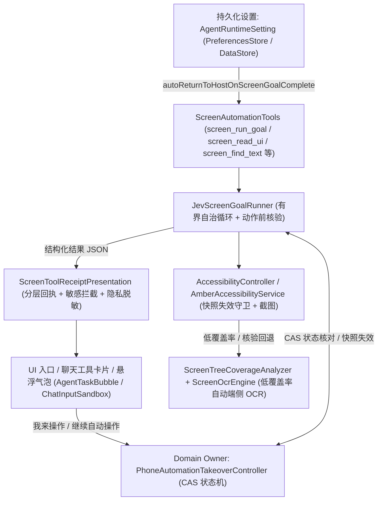

# Android 手机代操作差距收敛实施计划（Mika vs Amber Android）

> **基线日期**：2026-10-30  
> **工作目录**：`/Users/mi/Downloads/AI/AmberAgent/android`  
> **目标**：对齐 `wangzan101/Mika`（`7171a707`）与 `soul99soul-glitch/AmberAgent`（`b9fc668d`）在手机代操作上的四大核心差距，严格按 Phase 1 → Phase 4 顺序推进并完成每阶段 Subagent 审查与测试验证。

---

## 总体架构与状态流转

---

## Phase 1：后台操作连续性与宿主自动切回闭环

### 1.1 目标与边界
- **持久化配置**：在 `AgentRuntimeSetting`（[PreferencesStore.kt](file:///Users/mi/Downloads/AI/AmberAgent/android/core/settings/src/main/kotlin/app/amber/core/settings/PreferencesStore.kt)）新增 `autoReturnToHostOnScreenGoalComplete: Boolean = true`，通过 `SettingsAggregator` 暴露，并在 [SettingAgentExecutionPage.kt](file:///Users/mi/Downloads/AI/AmberAgent/android/app/src/main/java/app/amber/feature/ui/pages/setting/SettingAgentExecutionPage.kt) 提供开关与多语言文案。
- **自动切回宿主严格边界**：
  - 仅在 `status == "completed"`、`!dryRun`、目标 `packageName != hostPackageName`（非 Amber 自身）且开关启用（允许工具参数 `return_to_host` 显式覆盖）时，自动切回 Amber 宿主（`RouteActivity` `FLAG_ACTIVITY_NEW_TASK | FLAG_ACTIVITY_SINGLE_TOP | FLAG_ACTIVITY_CLEAR_TOP`）。
  - 当状态为 `unknown`（含 `outcome_unknown`）、`handback`、`needs_user_action`、`unavailable`、`disabled` 或处于人工接管暂停（`PAUSING` / `PAUSED`）时，**绝不抢占前台**，保持在目标应用界面以便用户查看或接管。
- **切回前快照强制失效**：
  - 在 [AccessibilityController.kt](file:///Users/mi/Downloads/AI/AmberAgent/android/core/automation/api/src/main/kotlin/app/amber/core/automation/AccessibilityController.kt) 与 [AmberAccessibilityService.kt](file:///Users/mi/Downloads/AI/AmberAgent/android/app/src/main/java/app/amber/core/automation/AmberAccessibilityService.kt) 新增快照显式失效能力（`invalidateSnapshot(snapshotId, reason)` / `isSnapshotInvalidated(snapshotId)`）。
  - 切回宿主前将最后观察到的目标应用快照标记为已失效（`returned_to_host_snapshot_invalidated`），后续任何持旧快照执行的 `performScreenAction` 立即返回 `stale_snapshot`（`dispatched = false`），杜绝误点 Amber 宿主界面。

### 1.2 涉及文件
- [AccessibilityController.kt](file:///Users/mi/Downloads/AI/AmberAgent/android/core/automation/api/src/main/kotlin/app/amber/core/automation/AccessibilityController.kt)
- [AmberAccessibilityService.kt](file:///Users/mi/Downloads/AI/AmberAgent/android/app/src/main/java/app/amber/core/automation/AmberAccessibilityService.kt)
- [PreferencesStore.kt](file:///Users/mi/Downloads/AI/AmberAgent/android/core/settings/src/main/kotlin/app/amber/core/settings/PreferencesStore.kt)
- [SettingAgentExecutionPage.kt](file:///Users/mi/Downloads/AI/AmberAgent/android/app/src/main/java/app/amber/feature/ui/pages/setting/SettingAgentExecutionPage.kt)
- `app/src/main/res/values*/strings.xml`
- [JevScreenGoalRunner.kt](file:///Users/mi/Downloads/AI/AmberAgent/android/app/src/main/java/app/amber/core/jev/JevScreenGoalRunner.kt)
- [ScreenAutomationTools.kt](file:///Users/mi/Downloads/AI/AmberAgent/android/app/src/main/java/app/amber/feature/tools/ScreenAutomationTools.kt)
- [JevScreenGoalRunnerTest.kt](file:///Users/mi/Downloads/AI/AmberAgent/android/app/src/test/java/app/amber/core/jev/JevScreenGoalRunnerTest.kt)

---

## Phase 2：控件树低覆盖率与视觉回退路径的端侧 OCR 自动兜底

### 2.1 目标与边界
- **默认零额外开销**：无障碍节点树文字覆盖正常且未显式开启 OCR 时，保持纯无障碍树观察，**零额外截图与零 OCR 开销**。
- **低覆盖率判定（`ScreenTreeCoverageAnalyzer`）**：
  - 统计节点总数、可见非空标签节点数、可交互节点（`clickable || editable || scrollable`）及其无标签占比、以及是否存在 `WebView` / `Canvas` / `SurfaceView` / `TextureView` / `FlutterView` 等自绘容器。
  - 当总节点为 0、可见文字节点为 0、自绘容器存在且文字节点 `<= 2`、整体标签覆盖率 `< 0.25f`（节点数 `>= 4`）或可交互节点无标签占比 `>= 0.75f`（可交互节点 `>= 3`）时，判定为 `isLowCoverage = true`。
- **端侧 OCR 与归一化坐标对齐（`ScreenOcrEngine`）**：
  - 定义 `ScreenOcrMode`（`AUTO` / `ON` / `OFF`）、`ScreenOcrBlock`（含文本、置信度、像素边界 `left/top/right/bottom` 与 `[0, 1]` 归一化坐标 `normLeft/normTop/normRight/normBottom/normCenterX/normCenterY`）及 `ScreenOcrObservation`。
  - 在 `screen_read_ui`、`screen_find_text`、`screen_tap_text`、`screen_wait_for_text`、`screen_scroll_until`、`screen_run_goal` 以及动作后 `verify_text` 核验中支持 `ocr_mode`（`"auto"` / `"on"` / `"off"`）与 `include_ocr` 显式开关。
  - 当 `ocr_mode == AUTO` 且低覆盖率（或 `verify_text` 无障碍树未命中需回退核验），或 `ocr_mode == ON` 时，自动触发端侧 OCR 并将结构化识别块与归一化坐标附带在结果中。

### 2.2 涉及文件
- `core/automation/api/src/main/kotlin/app/amber/core/automation/ScreenOcrModels.kt`
- `app/src/main/java/app/amber/core/automation/ScreenOcrService.kt`
- [ScreenAutomationTools.kt](file:///Users/mi/Downloads/AI/AmberAgent/android/app/src/main/java/app/amber/feature/tools/ScreenAutomationTools.kt)
- [JevScreenGoalRunner.kt](file:///Users/mi/Downloads/AI/AmberAgent/android/app/src/main/java/app/amber/core/jev/JevScreenGoalRunner.kt)
- [AgentInfraModule.kt](file:///Users/mi/Downloads/AI/AmberAgent/android/app/src/main/java/app/amber/core/di/AgentInfraModule.kt)
- `app/src/test/java/app/amber/core/automation/ScreenOcrFallbackTest.kt`

---

## Phase 3：聊天内与执行态人机接管（Takeover / Handoff）控制闭环

### 3.1 目标与边界
- **人机接管状态机（`PhoneAutomationTakeoverController`）**：
  - 状态：`IDLE`、`AUTOMATED`、`PAUSING`、`PAUSED`、`RESUMING`。
  - 采用 CAS（`MutableStateFlow.update` + 版本/epoch 校验）管理状态转换，并将最近会话接管状态持久化至本地状态存储。
  - 当用户点击“我来操作”或遇到敏感登录/验证码/支付拦截时，状态转入 `PAUSING -> PAUSED`，**立即使当前观察快照失效**（`takeover_invalidated`）。
  - 当用户点击“继续自动操作”时，状态转入 `RESUMING -> AUTOMATED`，执行器强制重新调用 `captureScreenSnapshot()` 获取全新快照，拒绝任何接管前的旧快照/旧节点引用，并通过 `dispatchedStepKeys` 保证已执行的副作用步骤绝不重放。
- **UI 入口与列表滚动性能保障**：
  - 在系统悬浮气泡（[AgentTaskBubbleContent.kt](file:///Users/mi/Downloads/AI/AmberAgent/android/app/src/main/java/app/amber/feature/bubble/AgentTaskBubbleContent.kt) / [AgentTaskBubbleController.kt](file:///Users/mi/Downloads/AI/AmberAgent/android/app/src/main/java/app/amber/feature/bubble/AgentTaskBubbleController.kt)）及聊天底部活跃任务控制栏（[ChatInputSandbox.kt](file:///Users/mi/Downloads/AI/AmberAgent/android/app/src/main/java/app/amber/feature/ui/components/ai/ChatInputSandbox.kt) / [ChatPage.kt](file:///Users/mi/Downloads/AI/AmberAgent/android/app/src/main/java/app/amber/feature/ui/pages/chat/ChatPage.kt)）提供一键“我来操作”与“继续自动操作”按钮（触控热区 `>= 48dp`）。
  - **性能红线**：[ChatMessageTools.kt](file:///Users/mi/Downloads/AI/AmberAgent/android/app/src/main/java/app/amber/feature/ui/components/message/ChatMessageTools.kt) 中的历史已完成消息仅消费不可变的 `UIMessagePart.Tool` 快照，不订阅高频 `StateFlow`，确保聊天列表滚动零额外开销。

### 3.2 涉及文件
- `app/src/main/java/app/amber/core/automation/PhoneAutomationTakeoverController.kt`
- [JevScreenGoalRunner.kt](file:///Users/mi/Downloads/AI/AmberAgent/android/app/src/main/java/app/amber/core/jev/JevScreenGoalRunner.kt)
- [ScreenAutomationTools.kt](file:///Users/mi/Downloads/AI/AmberAgent/android/app/src/main/java/app/amber/feature/tools/ScreenAutomationTools.kt)
- [AgentBubbleReducer.kt](file:///Users/mi/Downloads/AI/AmberAgent/android/app/src/main/java/app/amber/feature/bubble/AgentBubbleReducer.kt)
- [AgentTaskBubbleContent.kt](file:///Users/mi/Downloads/AI/AmberAgent/android/app/src/main/java/app/amber/feature/bubble/AgentTaskBubbleContent.kt)
- [AgentTaskBubbleController.kt](file:///Users/mi/Downloads/AI/AmberAgent/android/app/src/main/java/app/amber/feature/bubble/AgentTaskBubbleController.kt)
- [ChatInputSandbox.kt](file:///Users/mi/Downloads/AI/AmberAgent/android/app/src/main/java/app/amber/feature/ui/components/ai/ChatInputSandbox.kt)
- [ChatPage.kt](file:///Users/mi/Downloads/AI/AmberAgent/android/app/src/main/java/app/amber/feature/ui/pages/chat/ChatPage.kt)
- `app/src/test/java/app/amber/core/automation/PhoneAutomationTakeoverControllerTest.kt`

---

## Phase 4：任务交付回执分层、敏感最终动作保留确认与详情展示打磨

### 4.1 目标与边界
- **结构化回执模型（`ScreenToolReceiptPresentation.kt`）**：
  - 将 `screen_run_goal` 与 `screen_*` 工具的输入输出解析为分层视图模型，彻底告别原始 JSON 裸露：
    1. **已确认执行步骤回执（Confirmed Steps）**：展示步序、动作类型、目标控件标签/引用、执行状态（`ok` / `unknown` / `rejected`），并对输入文本做敏感内容掩码脱敏。
    2. **拦截保留的敏感最终动作（Held Sensitive Final Actions）**：在 `JevScreenGoalRunner` 记录被拦截或候选过滤的敏感动作（发送、提交、发布、支付、删除、权限确认、验证码/密码登录等），在卡片与详情弹窗中醒目提示“已为你保留最终敏感操作待确认”。
    3. **未满足的验收条件与原因（Unmet Acceptance Criteria & Reason）**：将 `handback` / `needs_user_action` / `done_not_verified` / `outcome_unknown` / `no_progress` / `verify_text_found=false` 映射为用户可读的验收说明。
    4. **端侧 OCR 识别摘要（On-Device OCR Summary）**：展示 OCR 是否触发、触发原因、文字块数量与树覆盖率，不泄露密码/验证码等敏感正文。
    5. **完成后切回 Amber 宿主状态（Host Return Status Badge）**：清晰标识“已自动切回 Amber”或“停留在目标应用待你继续操作”。
- **聊天工具卡片与详情弹窗改造**：
  - 在 [ChatMessageTools.kt](file:///Users/mi/Downloads/AI/AmberAgent/android/app/src/main/java/app/amber/feature/ui/components/message/ChatMessageTools.kt) 为手机代操作工具渲染紧凑分层摘要条（适配窄屏与大字号 Font Scale）。
  - 在 [ChatMessageToolPreviewSheet.kt](file:///Users/mi/Downloads/AI/AmberAgent/android/app/src/main/java/app/amber/feature/ui/components/message/ChatMessageToolPreviewSheet.kt) 新增专用 `ScreenToolPreview` 面板替代通用原始 JSON 视图。

### 4.2 涉及文件
- [ScreenToolReceiptPresentation.kt](file:///Users/mi/Downloads/AI/AmberAgent/android/app/src/main/java/app/amber/feature/ui/components/message/ScreenToolReceiptPresentation.kt)
- [ChatMessageTools.kt](file:///Users/mi/Downloads/AI/AmberAgent/android/app/src/main/java/app/amber/feature/ui/components/message/ChatMessageTools.kt)
- [ChatMessageToolPreviewSheet.kt](file:///Users/mi/Downloads/AI/AmberAgent/android/app/src/main/java/app/amber/feature/ui/components/message/ChatMessageToolPreviewSheet.kt)
- [ToolActivityTitleLocalizer.kt](file:///Users/mi/Downloads/AI/AmberAgent/android/app/src/main/java/app/amber/feature/runtime/ToolActivityTitleLocalizer.kt)
- [ScreenToolReceiptPresentationTest.kt](file:///Users/mi/Downloads/AI/AmberAgent/android/app/src/test/java/app/amber/feature/ui/components/message/ScreenToolReceiptPresentationTest.kt)

---

## 验收与执行状态（2026-10-30）

- **Phase 1（后台操作连续性与完成后自动切回宿主闭环）**：已完成、经子代理审查并修复，单元测试 `JevScreenGoalRunnerTest` 與 `:core:settings:testDebugUnitTest` 全部通过。
- **Phase 2（低覆盖率/自绘界面端侧 OCR 兜底与视觉回退）**：已完成、经子代理审查并修复，单元测试 `ScreenOcrFallbackTest` 全部通过。
- **Phase 3（对话流与执行态人工接管 / Handoff 控制闭环）**：已完成、经子代理审查并修复，单元测试 `PhoneAutomationTakeoverControllerTest` 与 `AgentBubbleReducerTest` 全部通过。
- **Phase 4（任务交付回执分层、敏感最终动作保留确认与详情展示打磨）**：已完成、经子代理审查并修复，单元测试 `ScreenToolReceiptPresentationTest` 与 `ToolActivityTitleLocalizerTest` 全部通过。
